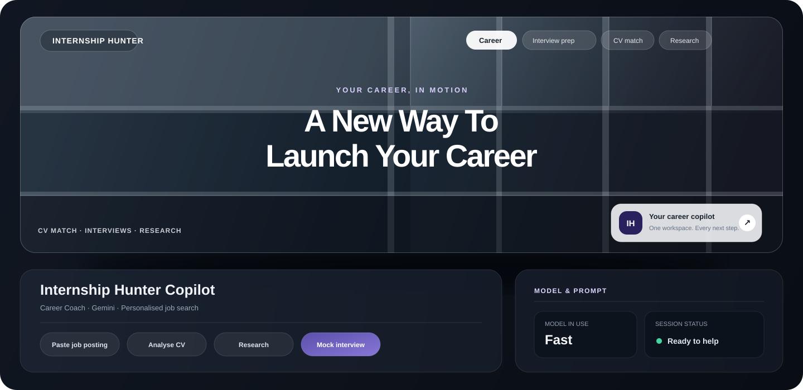

# Internship Hunter Copilot

<p align="center">
  
</p>

A Streamlit copilot for student internship hunting. Paste a job posting, and the app
researches the company with live web search, diffs your CV against the posting with a
**deterministic** gap analyzer, rewrites your CV bullets to target the role, runs a mock
interview that grades every answer, and remembers everything for the rest of the session.

The whole thing is a thin, readable wrapper around the patterns from the
**LangChain Academy: Introduction to LangGraph / LangChain foundations** notebooks —
and the app is deliberately transparent about it. A **Glass-box** panel shows you, live:
the exact model and system prompt in use, every tool call with its arguments and latency,
every source URL it read, and the full memory it is carrying.

> Built to be *read*. If you want to learn from the notebooks, the mapping from each
> notebook concept to the exact file/function that implements it is in
> [Notebook → code map](#notebook--code-map).

---

## Table of contents

- [What it does](#what-it-does)
- [Notebook → code map](#notebook--code-map)
- [Local setup](#local-setup)
- [Deploy to Streamlit Community Cloud](#deploy-to-streamlit-community-cloud)
- [Deploy to Hugging Face Spaces](#deploy-to-hugging-face-spaces)
- [2-minute demo script](#2-minute-demo-script)
- [Verifying it works](#verifying-it-works)
- [Project layout](#project-layout)
- [Limitations and honest caveats](#limitations-and-honest-caveats)

---

## What it does

### Four coaching modes

Switchable at any time from the sidebar, without losing the conversation.

| Mode | What it is for |
| --- | --- |
| **Career Coach** | Orchestrates the whole flow: research → gap analysis → tailored bullets. |
| **Recruiter** | Blunt screening view. Screens your fit and tells you what would get a reject. |
| **Technical Interviewer** | Asks one technical question at a time with adaptive difficulty, and scores each answer. |
| **Behavioral Interviewer (STAR)** | STAR questions with structure-level feedback on your answer. |

### Four tools the agent can call

| Tool | Kind | Why it exists |
| --- | --- | --- |
| `web_search` | Tavily, live network | The *only* source of outside facts. Without a Tavily key it degrades gracefully and says so. |
| `cv_gap_analyzer` | **Pure Python, no LLM** | Same CV + same posting ⇒ same verdict, every time, instantly, for free. |
| `score_answer` | Nested LLM call with `with_structured_output` | Forces a Pydantic-validated 1–10 grade instead of free-text hand-waving. |
| `save_note` | Session memory | Persists job-search facts so later turns can rely on them. |

### The Glass-box panel

Four tabs, updated on every turn:

- **Model & Prompt** — model id, temperature, current mode, and the *full* system prompt
  text that was actually sent.
- **Tool calls** — one row per call: name, arguments, latency, and the result payload.
- **Sources** — every URL the agent read, so you can check its claims.
- **Memory** — the notes saved this session plus the thread id and message count.

### Things worth clicking

- **Job-Fit card** — matched skills, missing skills, and nice-to-haves you do not have,
  as chips, with a single honest fit score.
- **Interview scoreboard** — `st.line_chart` of your score per question, so you can see
  the trend rather than one number.
- **Download report** — exports the whole session as Markdown.
- **Multimodal input** — attach a screenshot of a job posting, or record a spoken answer
  with the mic. Both go to Gemini as real `image` / `audio` content blocks.

---

## Notebook → code map

This is the part the app is really about. Each row is a notebook concept and where it lives.

| Notebook concept | Where to look | What to notice |
| --- | --- | --- |
| **1.1 — Foundational models** | `agent_factory.py` → `get_model()` | One `ChatGoogleGenerativeAI` per `(model, temperature)` pair, built once and reused. Swapping Gemini Flash for Pro is a one-word change with no other edits. |
| **1.1 — Prompting** | `prompts.py` → `MODE_PROMPTS`, `get_prompt()`, `prompt_diff()` | Four role prompts that share a common base and differ only in a persona + rules block. `prompt_diff()` diffs two modes so you can *see* what the mode switch changed. |
| **1.2 — Tools** | `tools.py` → the four `@tool` functions | Each tool has a docstring (that docstring *is* the model's API manual), typed args, and a `-> dict` return. `cv_gap_analyzer` is deliberately **not** an LLM call. |
| **1.2 — Web search** | `tools.py` → `web_search()` | `TavilyClient` behind a tool, with a `ContextVar` so tests never touch the network. Missing key ⇒ friendly error, never a traceback. |
| **1.3 — Memory** | `agent_factory.py` → `get_checkpointer()`, `make_config()`; `app.py` → `save_cv_to_memory()` | A single `InMemorySaver` shared by every agent, plus a `thread_id` per browser session. Conversation memory *and* explicit `save_note` facts are both durable across turns and across model/mode switches. |

### The two Streamlit-specific traps this app solves

Both of these break naive Streamlit + LangGraph apps, and both are handled explicitly:

1. **The checkpointer must be shared.** If each agent got its own `InMemorySaver`,
   switching models in the sidebar would silently wipe the conversation. Here
   `get_checkpointer()` is `@st.cache_resource`, and `get_agent(model, mode)` caches
   agents in a dict that *shares* that one checkpointer — so memory survives a model
   switch, a mode switch, and every rerun.
2. **Widget keys are immutable once created.** Streamlit raises
   `StreamlitValueAssignmentNotAllowedError` if you write to a widget key after the
   widget exists. Every sidebar key is therefore seeded exactly once through
   `seed_widget(key, default)` *before* the widget is created, and read back through
   `model_choice()`, `mode()`, `temperature()`, `tools_enabled()` which all supply
   their own defaults.

---

## Local setup

### Prerequisites

- Python 3.10+
- A **Gemini API key** — <https://aistudio.google.com/apikey> (required)
- A **Tavily API key** — <https://app.tavily.com> (optional; see below)

### Install and run

```bash
git clone <your-fork-url>
cd internship-hunter-copilot

python -m venv .venv
source .venv/bin/activate        # Windows: .venv\Scripts\activate

pip install -r requirements.txt

cp .env.example .env             # Windows: copy .env.example .env
```

Edit `.env`:

```bash
GOOGLE_API_KEY=your-gemini-key
TAVILY_API_KEY=your-tavily-key

# Optional: pin the models your key can access.
# GEMINI_FAST_MODEL=gemini-3.6-flash
# GEMINI_DEEP_MODEL=gemini-3.6-pro
```

Then:

```bash
streamlit run app.py
```

The app opens at <http://localhost:8501>.

> **If `GOOGLE_API_KEY` is missing**, the app shows a setup screen with instructions
> instead of a broken chat — you will never get a bare traceback for a missing key.
>
> **If `TAVILY_API_KEY` is missing**, the app still runs. `web_search` returns a friendly
> "research is disabled" message that the agent passes through, so it cannot hallucinate
> company facts. Look for the yellow dot next to the key in the sidebar.

### Files you should look at first

| File | Lines | Role |
| --- | --- | --- |
| `app.py` | ~970 | The whole UI. Sidebar, chat, multimodal input, glass box, fit card, scoreboard, report. |
| `agent_factory.py` | ~235 | Cached model, cached checkpointer, cached agents, the streaming loop. |
| `tools.py` | ~600 | The four tools, the session `ContextVar`, skill extraction, the Pydantic score schema. |
| `prompts.py` | ~330 | The four system prompts and the mode metadata. |
| `utils.py` | ~450 | Content-block handling, PDF/text parsing, session dataclasses, error classification, report builder. |

---

## Deploy to Streamlit Community Cloud

### 1. Put the project on GitHub

Create a new **empty** repository on <https://github.com/new>. Do not add a README,
`.gitignore`, or license there; this project already has those files. Choose Public if
you want anyone to see the source, or Private if you want to restrict source access.
The deployed app itself will still be public unless you configure access control.

In PowerShell, from the project folder, initialize Git and check what will be uploaded:

```powershell
git init -b main
git status --short
```

Confirm `.env` is **not** listed. It contains local secrets and is excluded by
`.gitignore`; never force-add it. If it appears in the status output, stop and fix the
ignore rule before continuing.

Add and push the project:

```powershell
git add -A
git status --short
git commit -m "Prepare Internship Hunter for deployment"
git remote add origin https://github.com/YOUR-USERNAME/YOUR-REPOSITORY.git
git push -u origin main
```

Replace the remote URL with the one shown on your GitHub repository page. If Git says
the `origin` remote already exists, inspect it with `git remote -v` and update it with
`git remote set-url origin <your-repository-url>` rather than adding a second remote.

### 2. Create the Streamlit app

1. Open <https://share.streamlit.io> and sign in with the GitHub account that can access
   the repository. Authorize Streamlit Community Cloud to access the repository if asked.
2. Choose **Create app** / **New app**, then select your GitHub repository and the
   `main` branch.
3. Set **Main file path** to `app.py`.
4. In **Advanced settings**, add the app's secrets as TOML:

   ```toml
   GOOGLE_API_KEY = "paste-your-gemini-key-here"
   TAVILY_API_KEY = "paste-your-tavily-key-here"
   # Optional: set model ids your Gemini key can access.
   # GEMINI_FAST_MODEL = "gemini-3.6-flash"
   # GEMINI_DEEP_MODEL = "gemini-3.6-pro"
   ```

   Get a Gemini key from <https://aistudio.google.com/apikey>. `GOOGLE_API_KEY` is
   required. `TAVILY_API_KEY` is optional, but company web research will be unavailable
   without it; get one from <https://app.tavily.com>.
5. Select **Deploy**. Cloud installs the packages from `requirements.txt` and reads the
   theme from `.streamlit/config.toml`; no custom build command is needed.
6. When the build finishes, open the app's `streamlit.app` URL and check the sidebar key
   indicators. If you add or change secrets later, save them in the app's settings and
   reboot the app.

Keep API keys in Streamlit's **Secrets** settings only. Do not put them in the README,
Python files, GitHub repository variables, or a committed `.env`. If a key has ever been
committed or shared publicly, revoke it and create a replacement before deploying.

### Troubleshooting

- **The setup screen says `GOOGLE_API_KEY` is missing:** verify the secret name is exact,
  the value is quoted TOML text, and the app was rebooted after saving the secret.
- **Research is unavailable:** `TAVILY_API_KEY` is optional; add it to the same Secrets
  settings to enable live web search.
- **The build fails:** open the app's **Manage app → Logs** and check the dependency
  installation output. Confirm that `requirements.txt` is at the repository root and
  the main file path is `app.py`.
- **A deployment uses old code:** push the latest commit to the selected branch and
  check the app's deployment logs.

Community Cloud apps are public by default. Do not upload a real CV or other sensitive
personal data to a public demo: this app keeps session data in server memory, and it is
cleared when the app restarts or redeploys.

Keys are read by `get_secret()`, which checks the real environment variable first and
then `st.secrets`. Environment wins so that a hosting platform's injected variable is
never clobbered by a stray local `.env` (loaded with `override=False`). `.env` is in
`.gitignore` and is never uploaded.

## Deploy to Hugging Face Spaces

1. Create a new Space with the **Streamlit** SDK.
2. Upload the app files, keeping this layout:

   ```
   app.py
   agent_factory.py
   tools.py
   prompts.py
   utils.py
   requirements.txt
   .streamlit/config.toml
   ```

3. Under **Settings → Variables and secrets**, add `GOOGLE_API_KEY` and `TAVILY_API_KEY`
   as **Secrets** (not plain variables).
4. Wait for the build. Check the **Logs** tab if the app shows the setup screen — it
   will tell you which key it could not find.

---

## 2-minute demo script

Use this if you are presenting. It is built to show the Glass-box panel, so keep it
expanded on the right side of the screen.

**0:00 — Prove it is grounded.** Open the app. Point at the sidebar. "Two keys: Gemini
required, Tavily optional. The dot is green, so research is live."

**0:15 — Feed it a job.** Click **📄 Paste job posting** and paste a real posting — Stripe,
Datadog, or a local company. The agent searches the web, and you immediately see three
things in the Glass box: the **Tool calls** tab fills with `web_search` rows, the
**Sources** tab lists the URLs it actually read, and the **Model & Prompt** tab shows the
exact prompt it is running under.

**0:45 — Prove the analysis is deterministic.** Click **🎯 Analyse CV vs job**. The Job-Fit
card appears with matched / missing / nice-to-have chips. Say: "No LLM call. Same CV, same
posting, same number — every time. An LLM would have given me a different confidence score
on Tuesday."

**1:15 — Make it personal.** Click **✏️ Tailor my CV bullets**. Then in the **Memory** tab,
show that your CV was saved to the thread without spending a model call.

**1:45 — Run an interview.** Click **🎤 Start mock interview**. Answer one question. It
scores you 1–10, and the **scoreboard** plots the trend across questions so you can see
improvement rather than a single verdict.

**2:00 — Close on transparency.** Point at the **Memory** tab and say: "Everything it
knows about me is right here, and I can see the whole prompt. If it cites a source, I can
click it. That's the difference between an assistant and a black box." Download the
Markdown report as you finish.

---

## Verifying it works

Three dependency-light suites ship with the repo. None of them need a real API key, so
you can prove the app is sound before spending anything:

```bash
python _selftest.py    # tools, prompts, utils - pure logic, no network, no LLM
python _agenttest.py   # the LangGraph agent: memory, streaming, multimodal (fake model)
python _apptest.py     # the real Streamlit UI via streamlit.testing AppTest
python _deepprobe.py   # adversarial: degenerate + hostile input on every entry point
python _livesmoke.py   # REAL billable calls: Gemini + Tavily + one agent turn
```

| Suite | What it proves |
| --- | --- |
| `_selftest.py` | `cv_gap_analyzer` determinism, skill aliases, `save_note` session wiring and its length clamp, the `score_answer` no-key fallback, CV/PDF text parsing, report assembly, graceful `web_search` degradation. |
| `_agenttest.py` | One `InMemorySaver` shared across agents, memory surviving a mode switch, `update_state` CV injection, the `stream_turn` event contract (`tool_call` → `tool_result` → `final`), and image/audio content blocks surviving a real graph run. |
| `_apptest.py` | The setup screen appears with no key, all four glass-box tabs render, 3 consecutive reruns stay clean, `thread_id` is stable across reruns/mode/model switches, **New session** rotates the thread but keeps your CV, and a failing key yields a friendly message rather than a traceback. |
| `_deepprobe.py` | Everything the others skip: `None`/empty/malformed-JSON/unicode input, a CV textarea round-trip including the unsaved-draft warning, hostile HTML in skill names *and* in web-search results, 20 000-character chat input, temperature 0.0/0.95/1.0, and 3× **New session** in a row. |
| `_livesmoke.py` | **Spends real money.** `--model-only` proves the key and model id for the price of one "PONG"; the full run adds a Tavily search and one live agent turn, then checks that tool calls, sources and checkpoint memory all populated. |

All four stub out `dotenv.load_dotenv`, so they behave identically whether or not you
have a real `.env` next to `app.py` — a suite that only passes on a machine with no keys
is not a suite.

They are development helpers, not part of the app — `app.py` never imports them. Delete
them if you want a minimal repo.

---

## Project layout

```
internship-hunter-copilot/
├── app.py                     # Streamlit UI
├── agent_factory.py           # cached model + checkpointer + agent + streaming loop
├── tools.py                   # the four @tool functions
├── prompts.py                 # four system prompts + mode metadata
├── utils.py                   # content blocks, PDF parsing, session state, errors, report
├── requirements.txt
├── .env.example               # copy to .env
├── .gitignore                 # ignores .env and secrets
├── .streamlit/config.toml     # theme + server settings
├── README.md
│
└── dev-only verification suites (safe to delete):
    ├── _selftest.py           # pure-logic checks, no network
    ├── _agenttest.py          # LangGraph agent checks, fake model
    ├── _apptest.py            # Streamlit AppTest
    ├── _deepprobe.py          # adversarial / hostile-input probe
    └── _livesmoke.py          # live, BILLABLE Gemini + Tavily check
```

---

## Limitations and honest caveats

**Memory is in-process and dies with the server.** The checkpointer is
`InMemorySaver`, which keeps the conversation in RAM. Restarting the app — or, on
Community Cloud, redeploying or going idle — wipes every thread. Your CV, notes, and
transcript are gone. The CV textarea is also in `st.session_state`, so it is lost on a
full page reload unless you press **Save CV to memory** first.

*To fix it:* swap `InMemorySaver` for a persistent checkpointer. LangGraph ships
`SqliteSaver` (single file, good for one user) and `PostgresSaver` (multi-user, needs a
database and a `setup()` call). The only change needed is inside `get_checkpointer()` —
nothing else in the app knows what the checkpointer is. This is a deliberate choice for
the demo: it keeps the deployment free and the code focused on the notebook concepts,
but it is the first thing to change for real use.

Other caveats worth knowing:

- **Cost.** Every turn is a live Gemini call, and `score_answer` adds a nested call on
  top. Interview mode is the most expensive path. Use the **Fast** model and a low
  temperature while iterating.
- **Skill extraction is heuristic.** `cv_gap_analyzer` matches a curated alias list
  (`react` ≡ `react.js` ≡ `reactjs`). A skill outside that list is invisible to it, so a
  low fit score means "not matched by the matcher", not "you are unqualified". The
  interviewer's read, which does use the LLM, is the softer signal.
- **Fit score is not a probability.** It is `0.8 × (required skills matched) + 0.2 ×
  (nice-to-haves matched)`, scaled to 0–100, and reported as `0` rather than invented when
  the posting yields no extractable requirements. When a posting lists *no* nice-to-haves
  there is nothing to miss, so the full 100% falls onto the required skills — otherwise the
  same CV would score ~20 points higher on a posting that omits the section. It exists to
  make the gap concrete, not to predict a recruiter.
- **Tailored bullets can drift.** The prompt forbids inventing experience, but it is still
  an LLM. Read the diff before you send anything to a recruiter.
- **`showErrorDetails = true`** in `.streamlit/config.toml` so you can debug a live demo.
  Set it to `false` before exposing this to untrusted users.
- **The CV is sent to Google.** If you uploaded a real CV, its contents went to the
  Gemini API and any web search text went to Tavily. Both are third parties.
- **No auth.** Anyone who finds your deployed URL shares one app instance. There is no
  per-user isolation beyond the per-browser `thread_id`.